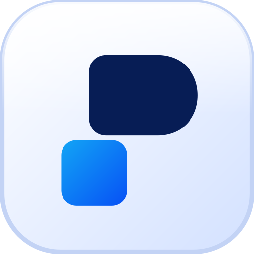

<div align="center">



# PersonalHQ

**A self-hosted home for your tasks, notes, habits and money.**
One place, one person, your own server — and an MCP endpoint so an AI assistant can work with it too.

Next.js 16 · React 19 · Tailwind CSS 4 · SQLite (libSQL + Drizzle) · installable PWA · MIT

</div>

---

## Why

Most life-admin apps split your day across several subscriptions and keep your data on someone else's servers. PersonalHQ puts the essentials in one calm dashboard that you run yourself: your data is a single SQLite file you can back up, move or delete.

## Features

**Overview** — your day at a glance: tasks due soon, today's habits, pinned notes, trackers and this month's money, with one-tap ticking.

**Tasks**
- Groups (Work, Home, Study…) with an icon and colour, shown as a **checklist** or a **board** with your own columns (rename, reorder, choose which counts as done)
- Subtasks, labels, notes, due date and time, and **reminders** (notifications while the app is open)
- *All tasks* sorted into Overdue, Today, Next 7 days, Later and No date

**Notes** — Google Keep-style text and checklist notes with colours, pinning, drag-to-reorder, categories, search and an archive.

**Trackers** — track anything:
- **Habits** with streaks (daily, or N times a week/month) and a calendar
- **Amounts** that add up or average per day/week/month (water, pages, sleep), with a goal *or* a limit
- **Readings** with a target (weight, odometer), **days since** counters with resets, and a daily **mood** rating

**Finance**
- Income, expenses, investments and donations with categories
- **Wallets** — bank accounts, cash, mobile wallets (bKash, Nagad…) and cards; balances update as you record money, with transfers (and fees) and balance adjustments
- **Analytics** — date ranges (this month, last month, 3/6 months, this year, custom), comparisons with the previous period, cash-flow and spending charts, category breakdowns and your biggest expenses
- Paginated history with search and category/wallet filters

**Everywhere**
- **Installable app** on phones, tablets and desktops: app-style navigation, bottom sheets, pull-to-refresh, an offline screen and home-screen shortcuts
- **Themes**: light, dark or follow the device, in eight styles — Lavender, Ocean, Teal, Forest, Sunset, Rose, Graphite and an Apple-style **Liquid Glass**; colour-blind-safe chart colours
- **MCP server** (`/api/mcp`) with 44 tools, so Claude or any MCP client can read and update your tasks, notes, trackers and finances
- **Backup and restore** — the whole dashboard as one JSON file

## Quick start

Requires **Node.js 20.9+** and **pnpm**.

```bash
git clone https://github.com/muktoapb/PersonalHQ.git
cd PersonalHQ
pnpm install
pnpm dev            # http://localhost:3000
```

Open the app and the setup screen asks for **your name**, a **username**, a **password** and how it should look (light/dark and a colour theme). Currency (USD, $), number format and the rest start with defaults you can change in Settings. The database is created and migrated automatically. You're then shown a **recovery key** once — save it, it's how you reset a forgotten password.

## Running in production

```bash
pnpm build
pnpm start          # serves on port 3000
```

- **Serve it over HTTPS** (Caddy, nginx, Cloudflare Tunnel…). Installing the app on a phone requires HTTPS, and the session cookie is marked `Secure` in production.
- **Use a reverse proxy that sets `X-Forwarded-For`.** Sign-in lockouts are per client address; exposed directly, a client could forge that header.
- **Back up `data/dashboard.db`**, or use *Settings › Data › Download backup*.

### Configuration

Copy `.env.example` to `.env.local`:

| Variable | Default | Purpose |
|---|---|---|
| `DATABASE_URL` | `file:./data/dashboard.db` | SQLite file, or a `libsql://…` URL for [Turso](https://turso.tech) |
| `DATABASE_AUTH_TOKEN` | — | Turso auth token |

Everything else (your account, currency, MCP access) lives in the database and is managed in the app.

### Where to host

| Where | Database |
|---|---|
| Your own server, VPS or home server | the SQLite file (default) |
| Vercel or other serverless hosts | Turso — serverless disks are wiped, so a local file won't persist |

## Security

- One account per install; passwords are hashed with **scrypt**.
- After 5 failed sign-ins an address is locked out for 1 minute, doubling up to an hour (stored in the database, so restarts don't reset it).
- **Forgot your password?** Use your recovery key on the sign-in screen. Lost that too? On the server run:

  ```bash
  pnpm reset-password
  ```

- *Settings › Profile* lets you change your username and password, make a new recovery key and sign out other devices.
- The MCP token is shown once and only its hash is stored; creating or replacing it needs your password, and a password reset revokes it.
- Security headers stop the app being framed by other sites (clickjacking) and MIME sniffing.

Found a security issue? Please report it privately through GitHub's security advisories instead of a public issue.

## Connect an AI assistant (MCP)

In **Settings › MCP**, create a token, then add the server to your client. With Claude Code:

```bash
claude mcp add --transport http personalhq https://your-host/api/mcp \
  --header "Authorization: Bearer YOUR_TOKEN"
```

Other clients that support remote MCP servers with custom headers can use the same URL and header. The endpoint is stateless Streamable HTTP; revoking the token disconnects every client.

## Development

| Command | What it does |
|---|---|
| `pnpm dev` | Start the dev server |
| `pnpm build` / `pnpm start` | Production build / server |
| `pnpm lint` / `pnpm typecheck` | ESLint / TypeScript |
| `pnpm db:generate` | Create a migration after editing `src/db/schema.ts` |
| `pnpm db:migrate` | Apply migrations (also runs automatically on start) |
| `pnpm db:studio` | Browse the database |
| `pnpm reset-password` | Set a new password from the server |

```
src/
  app/(auth)/      setup, sign-in, forgot password
  app/(app)/       overview, tasks, notes, trackers, finance, settings
  app/api/         MCP endpoint, backup export
  components/      UI
  db/              Drizzle schema and client
  lib/core/        business rules — shared by the UI and the MCP tools
  lib/actions/     server actions: check the session → core → revalidate
  lib/mcp/         MCP server and tools
drizzle/           SQL migrations
scripts/           command-line helpers
```

**Schema changes:** edit `src/db/schema.ts`, run `pnpm db:generate` and commit the new file in `drizzle/`. It's applied on the next start.

**Conventions:** business logic lives in `lib/core` (validated with zod, returning a `Result`), so the web UI and the MCP tools behave the same. Money is stored as integer minor units (cents) so totals never drift.

## Roadmap

- Reminders while the app is closed (Web Push)
- CSV import/export and recurring transactions
- Budgets per category
- Docker image

Ideas and pull requests are welcome — for bigger changes, please open an issue to discuss first.

## License

[MIT](LICENSE)
